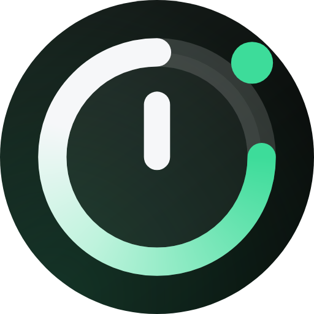
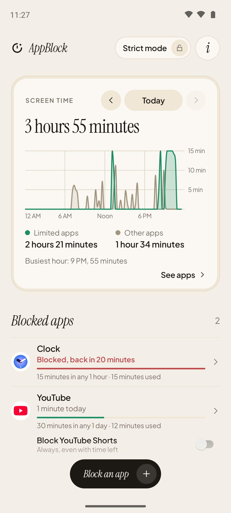
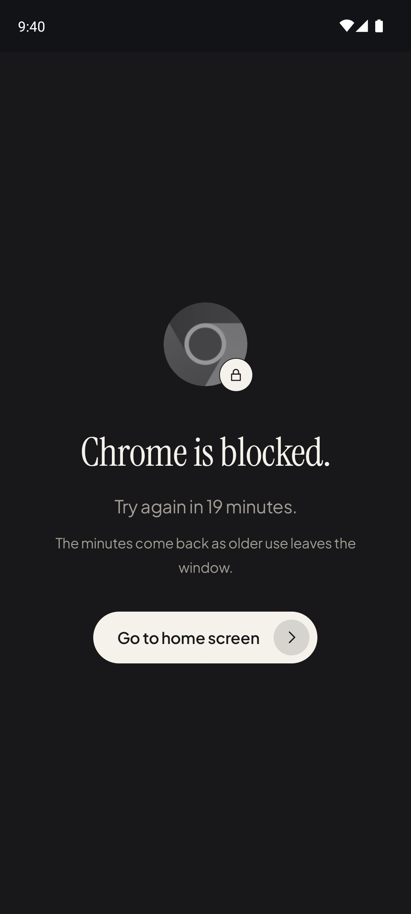
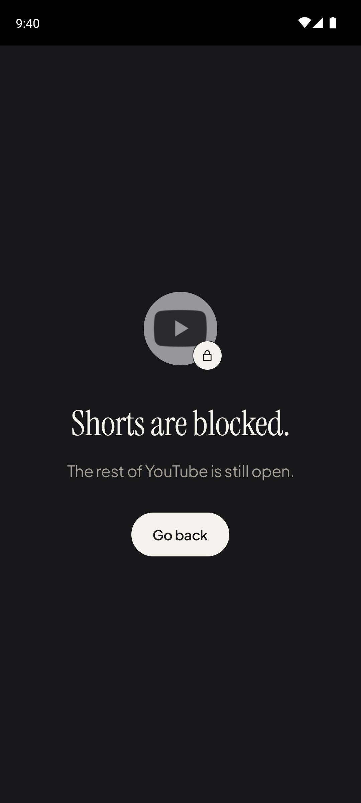
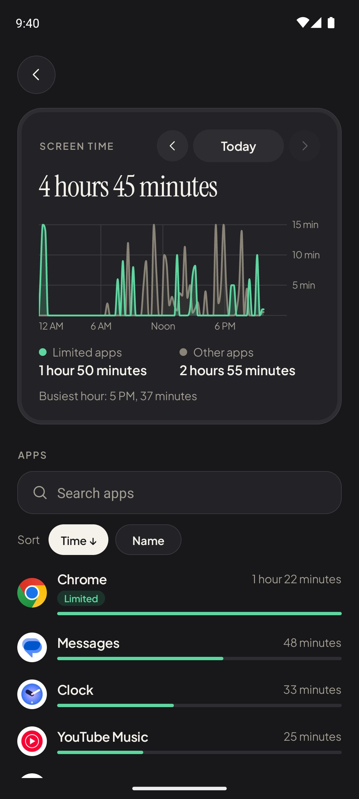
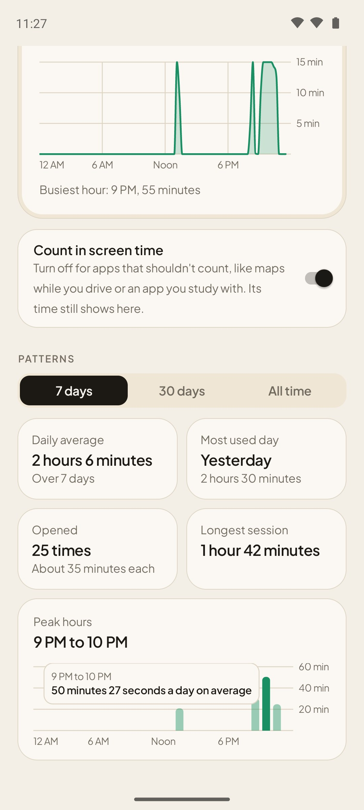
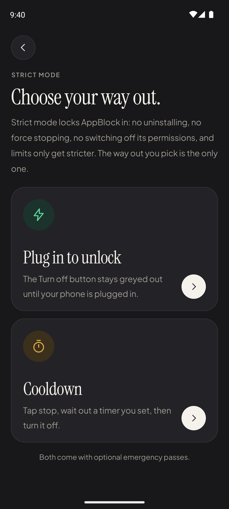
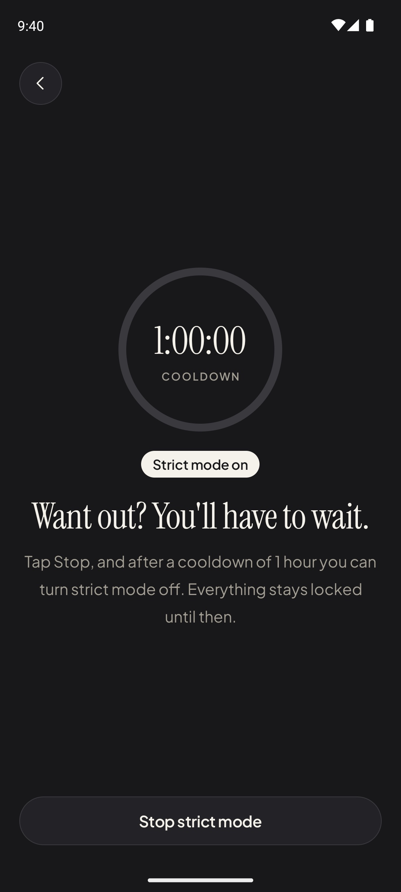
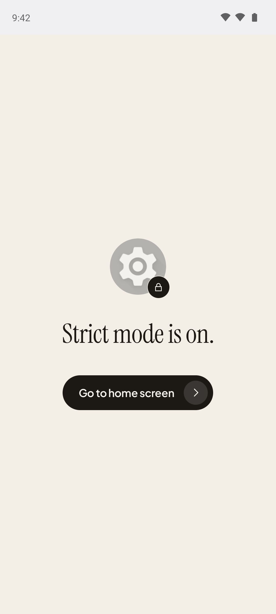
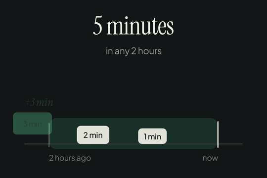

  

<h1 align="center">AppBlock</h1>

  A few minutes per app, every few hours. Not a daily quota that's gone an hour after you wake up.
   
  <a href="https://trymoly.com">Website</a>

<table>
  <tr>
    <td width="25%">
      
      <h3 align="center">Rolling limits</h3>
      
Give each app a budget: 10 minutes in any hour, say.

    </td>
    <td width="25%">
      
      <h3 align="center">The wall</h3>
      
Spend it and the app is walled until the minutes come back.

    </td>
    <td width="25%">
      
      <h3 align="center">No Shorts, no Reels</h3>
      
Block YouTube Shorts and Instagram Reels. The rest of the app stays open.

    </td>
    <td width="25%">
      
      <h3 align="center">Screen time</h3>
      
Your day, every app in it, kept on your phone.

    </td>
  </tr>
  <tr>
    <td width="25%">
      
      <h3 align="center">Patterns</h3>
      
Each app's daily average, longest session and peak hours.

    </td>
    <td width="25%">
      
      <h3 align="center">Strict mode</h3>
      
Lock AppBlock in. Pick your way out: plug in, or a cooldown.

    </td>
    <td width="25%">
      
      <h3 align="center">Wait it out</h3>
      
Want out? Tap Stop and wait out the cooldown first.

    </td>
    <td width="25%">
      
      <h3 align="center">No back door</h3>
      
No uninstalling, no force stop, no switching it off.

    </td>
  </tr>
</table>

<h3 align="center">What's a rolling window?</h3>

  

  A limit like 5 minutes in any 2 hours is a window that keeps moving.
   
  As old use slides out the back, those minutes come back, so there's no midnight reset to burn through in one sitting.

<h3 align="center">Why I made it</h3>

  One morning I woke up at 5am and scrolled Instagram, X and YouTube for an hour straight.
   
  My entire daily quota, gone before sunrise.

  That's when it clicked: daily limits fail because one binge empties them, and then you override.
   
  AppBlock gives you a small allowance every time window instead.

  Enough to check in, never enough to binge.

made with ❤️ by <a href="https://rubberpencils.com/">rubberpencils</a>

